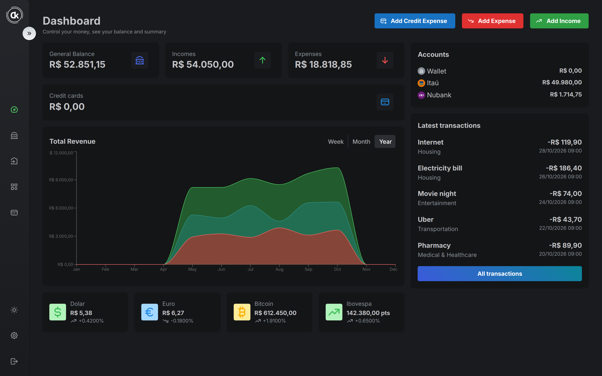
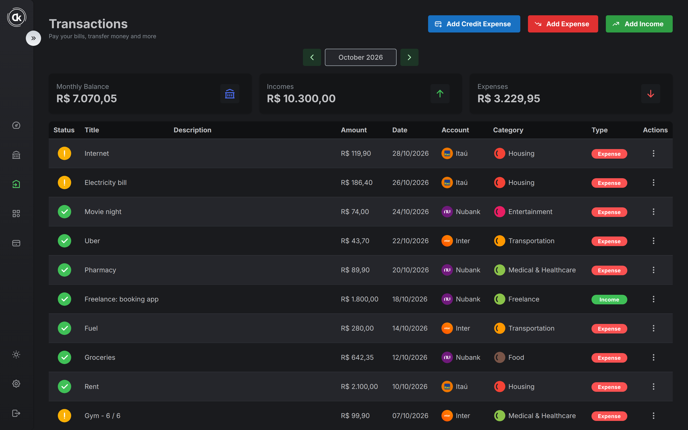
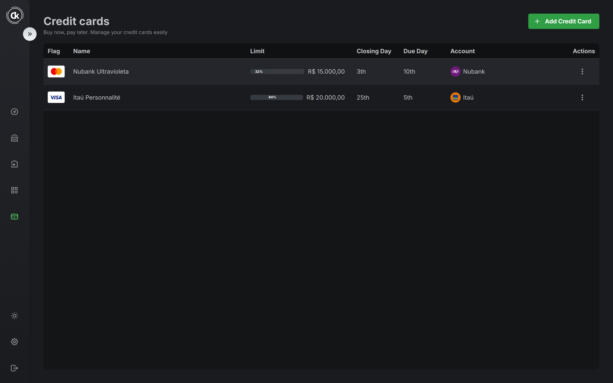
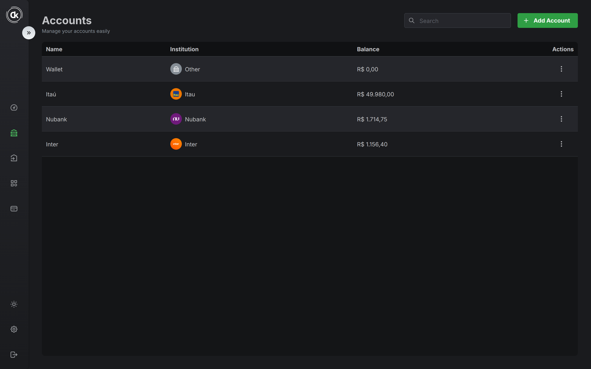
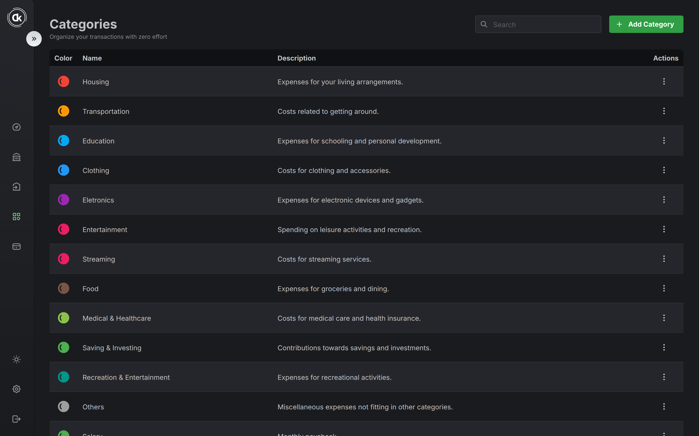
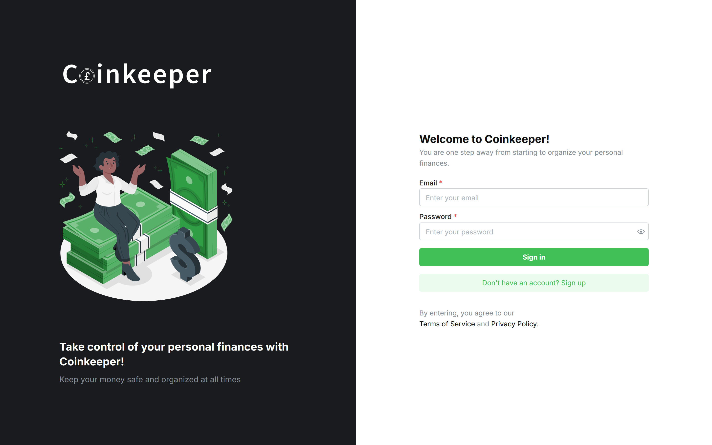
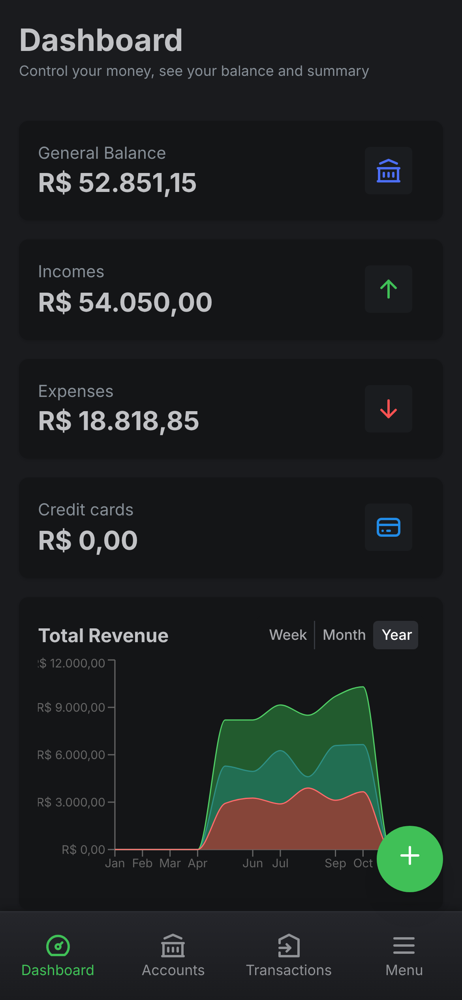
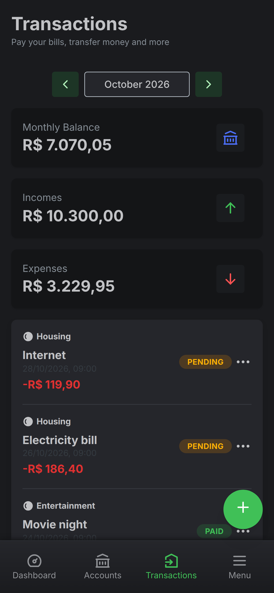
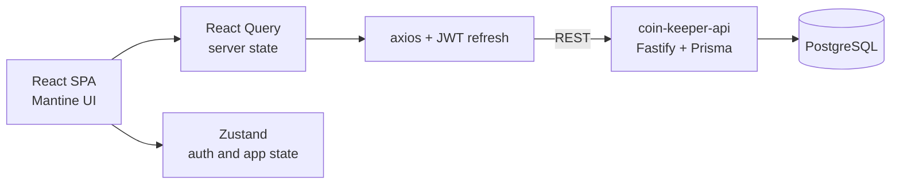

<div align="center">

<picture>
  <source media="(prefers-color-scheme: dark)" srcset="src/assets/logo/logo.svg" />
  
</picture>

<br />
<br />

**A personal finance tracker for bank accounts, transactions and credit cards.**


[Features](#features) •
[Screenshots](#screenshots) •
[Architecture](#architecture) •
[Tech stack](#tech-stack) •
[Running locally](#running-locally) •
[History](#project-history)

</div>

> [!WARNING]
> **Discontinued.** Coin Keeper is no longer maintained. This repository is archived and kept as a portfolio reference. There is no live demo, and some private packages it depends on are no longer on npm (see [Running locally](#running-locally)).



## About

Coin Keeper was a side project I built in 2023–2024 to manage my own money: where it sits, where it goes and what the credit cards will charge next month. It is a React single-page app that talks to [coin-keeper-api](https://github.com/RanielliMontagna/coin-keeper-api), a Fastify and PostgreSQL backend I wrote alongside it.

It was also a playground for the shared component library I maintained at the time, [quantun](https://github.com/RanielliMontagna/quantun), which provides the login and sign-up screens and several UI helpers.

## Features

- **Dashboard**: general balance, total income and expenses, balance per account, latest transactions, an income vs. expense chart by week, month or year, and live USD, EUR, BTC and Ibovespa quotes.
- **Accounts**: bank accounts with institution logos (Nubank, Itaú, Inter, Bradesco, Santander and others) and a running balance.
- **Transactions**: income and expenses with a month picker, monthly balance, paid/pending status and one-click "mark as paid".
- **Recurring transactions**: weekly, monthly or yearly series, shown as numbered installments (`Gym - 6 / 6`).
- **Credit cards**: brand, limit usage, closing and due days, linked account and card expenses added to the monthly invoice.
- **Categories**: a starter set created at sign-up plus your own, each with a colour.
- **Settings**: automatically mark transactions as paid on their due date.
- **Responsive and installable**: data tables on desktop, card lists with a bottom bar and a floating action button on mobile, dark and light themes, and a PWA manifest.
- **Auth**: sign-up and sign-in with JWT access tokens and refresh tokens.

## Screenshots

<table>
  <tr>
    <td width="50%"><p align="center"><sub>Transactions by month</sub></p></td>
    <td width="50%"><p align="center"><sub>Credit cards</sub></p></td>
  </tr>
  <tr>
    <td width="50%"><p align="center"><sub>Accounts</sub></p></td>
    <td width="50%"><p align="center"><sub>Categories</sub></p></td>
  </tr>
  <tr>
    <td colspan="2"><p align="center"><sub>Sign in</sub></p></td>
  </tr>
</table>

<p align="center">
  
  &nbsp;&nbsp;
  
</p>

<sub>Screenshots taken in October 2026 from a local run with sample data. Currency quotes are sample values.</sub>

## Architecture



```text
src/
├── api/            # axios clients per resource (accounts, transactions, credit cards…)
├── containers/     # pages: dashboard, accounts, transactions, categories, credit cards, settings
├── components/     # shared UI: data table, mobile list, bottom bar, FAB, currency input
├── layouts/        # public and private layouts
├── routes/         # React Router routes guarded by the auth token
├── store/          # Zustand stores
└── test/           # Vitest setup, helpers and specs
cypress/e2e/        # end-to-end flows for categories and credit cards
```

## Tech stack

| Area | Tools |
| --- | --- |
| UI | React 18, TypeScript, Mantine 6, mantine-datatable, Tabler Icons, Framer Motion, Recharts |
| Data and state | React Query 3, Zustand, axios, Zod, Day.js |
| Routing | React Router 6 |
| Build | Vite 4, vite-plugin-pwa |
| Tests | Vitest, Testing Library, Cypress |
| Tooling | ESLint, Prettier, Docker |
| Hosting | Vercel (no longer online) |

## Running locally

You need [coin-keeper-api](https://github.com/RanielliMontagna/coin-keeper-api) running first.

The app depends on five `@quantun/*` packages from my [quantun](https://github.com/RanielliMontagna/quantun) monorepo. They were removed from npm in 2026, so a plain install fails with `404 Not Found`. Build them from source and point the app at the tarballs:

<details>
<summary>Step by step (last checked in October 2026 on Node.js 24)</summary>

```bash
# 1. Build the @quantun packages
mkdir quantun-tgz
git clone https://github.com/RanielliMontagna/quantun.git
cd quantun
npx pnpm@8 install --no-frozen-lockfile --ignore-scripts
for d in packages/quantun-core packages/quantun-hooks packages/quantun-utils \
         templates/quantun-login-screen templates/quantun-register-screen; do
  (cd "$d" && npx pnpm@8 run build && npx pnpm@8 pack --pack-destination ../../../quantun-tgz)
done
cd ..

# 2. Install the app against the local tarballs
git clone https://github.com/RanielliMontagna/coin-keeper.git
cd coin-keeper
node -e '
const fs = require("fs")
const p = JSON.parse(fs.readFileSync("package.json"))
const tgz = fs.readdirSync("../quantun-tgz")
for (const name of Object.keys(p.dependencies).filter((n) => n.startsWith("@quantun/"))) {
  const file = tgz.find((f) => f.startsWith("quantun-" + name.split("/")[1] + "-"))
  p.dependencies[name] = "file:../quantun-tgz/" + file
}
delete p.devDependencies["@quantun/prettier"]
delete p.devDependencies["eslint-config-quantun"]
fs.writeFileSync("package.json", JSON.stringify(p, null, 2))
'
CYPRESS_INSTALL_BINARY=0 npx yarn@1 install --ignore-engines   # yarn.lock is the up-to-date lockfile

# 3. Run
cp .env.example .env    # VITE_API_URL=http://localhost:3333
npx vite                # http://localhost:8080
```

</details>

## Tests

```bash
yarn test               # Vitest unit and component tests
yarn test:coverage
yarn test:e2e           # Cypress, needs the app and the API running
```

## Project history

- **April 2023**: project started with Firebase auth, Vitest and a PWA setup.
- **June 2023**: moved from Firebase to the custom API, translated the UI to English and built the dashboard with quotes.
- **July 2023**: accounts, categories, transactions, charts and credit cards.
- **February–March 2024**: recurring transactions, paid status, mobile list, floating action button and credit card expenses.
- **March 2024**: last feature work.
- **2024–2025**: automated dependency upgrades only.
- **October 2026**: archived.

## Related

- [coin-keeper-api](https://github.com/RanielliMontagna/coin-keeper-api): the Fastify, Prisma and PostgreSQL backend.
- [quantun](https://github.com/RanielliMontagna/quantun): the component library used for the auth screens and helpers.

## Author

Built by [Ranielli Montagna](https://github.com/RanielliMontagna) · [ranimontagna.com](https://ranimontagna.com)
